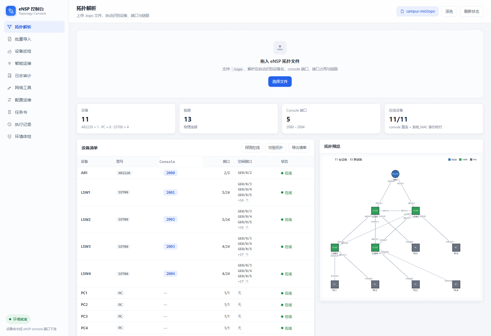
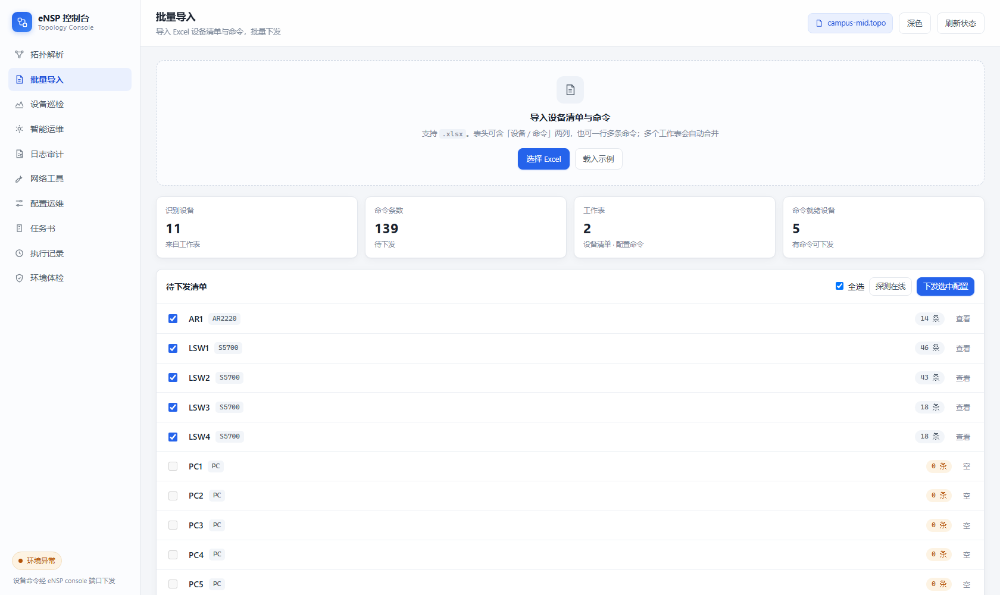
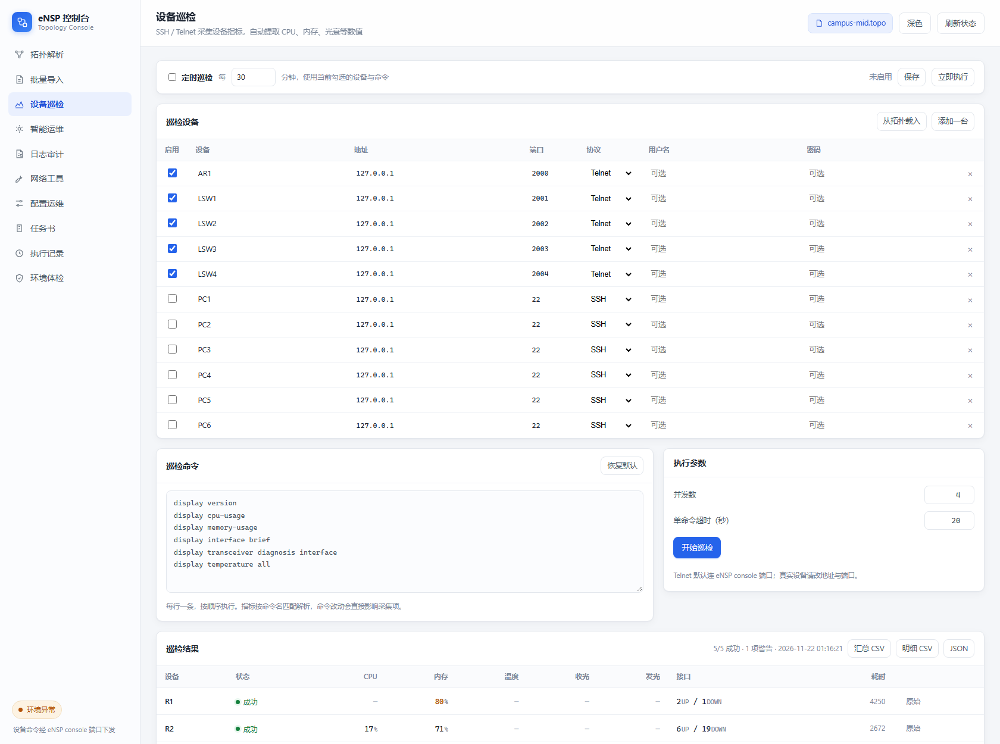
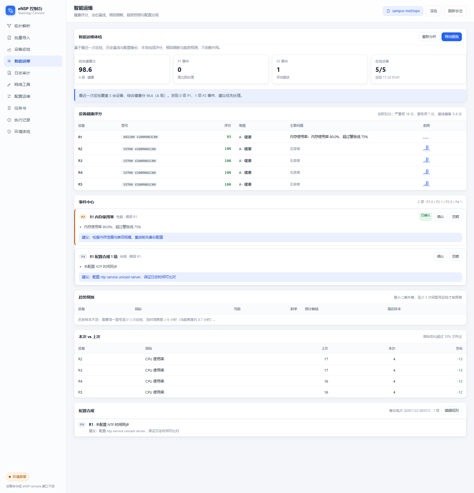
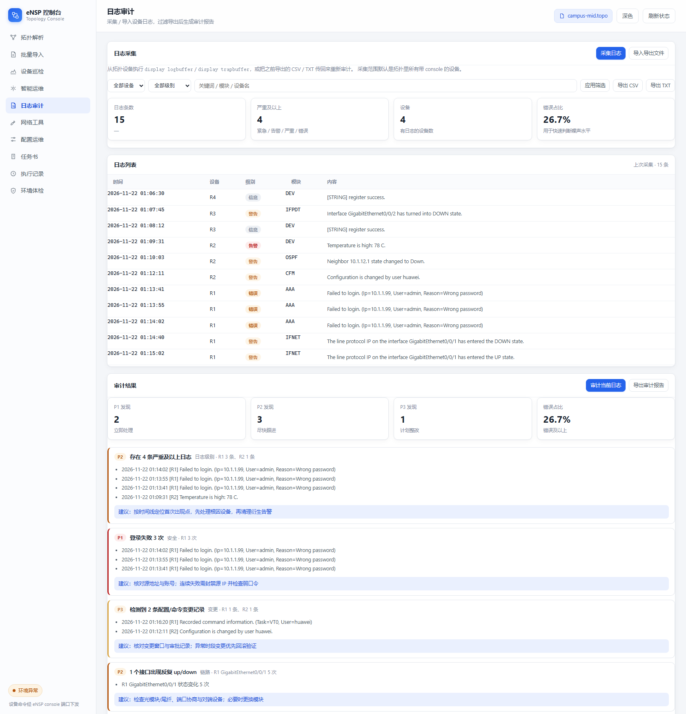
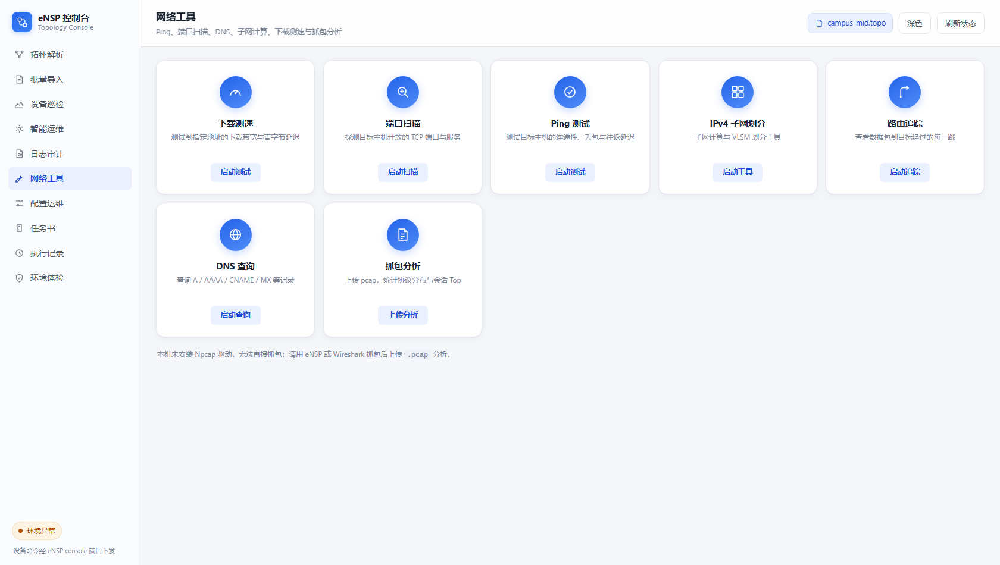
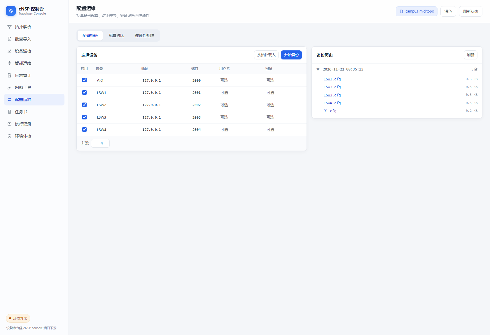
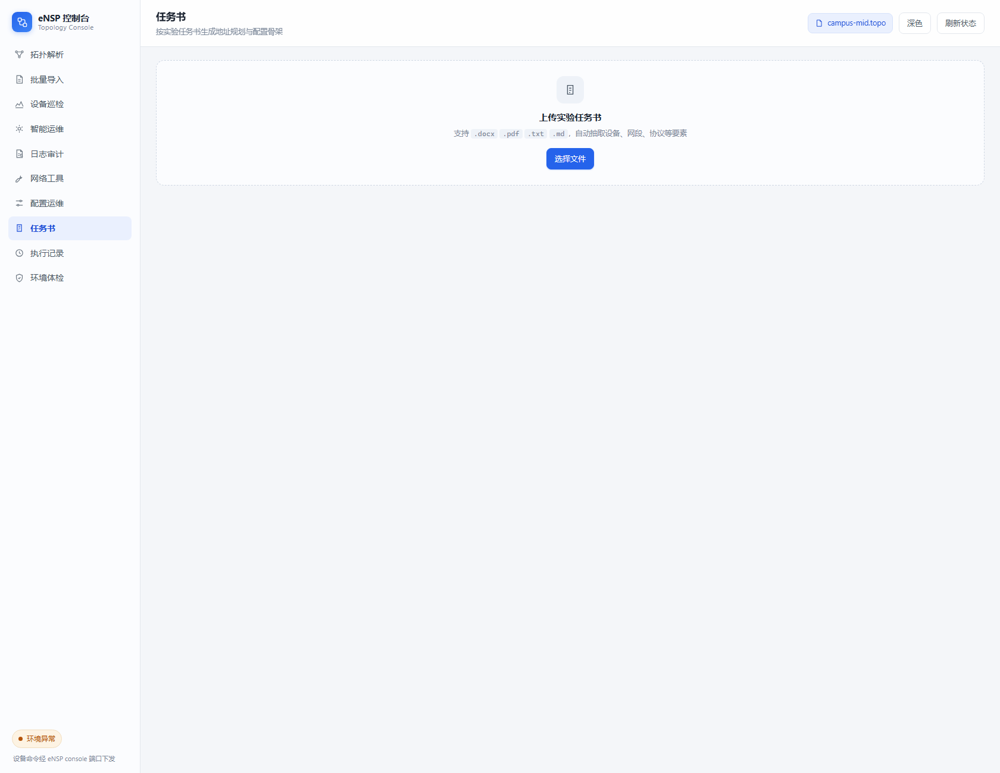
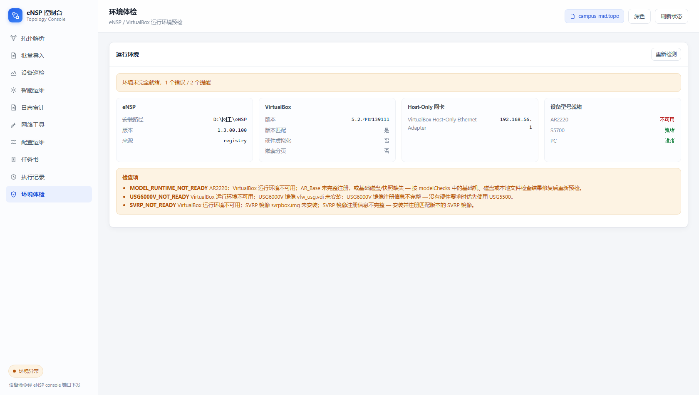

# eNSP 拓扑控制台

面向华为 eNSP 的本地网络实验运维控制台：从拓扑解析、批量配置下发、设备巡检，到智能运维分析、日志审计与报告导出，全部在一个本地网页里完成，不依赖外网与大模型。

- **运行形态**：本地 FastAPI 服务 + 原生 JS 前端（无构建步骤）
- **访问地址**：`http://127.0.0.1:8765`
- **设备通道**：eNSP console 端口（Telnet）或真实设备 SSH
- **操作系统**：Windows（依赖 eNSP + VirtualBox 运行环境）



> 文档中的截图基于仓库 `samples/` 附带的校园网演示拓扑（1 台 AR + 4 台交换机 + 6 台 PC，11 设备 / 13 链路）。

---

## 目录

- [快速开始](#快速开始)
- [功能模块](#功能模块)
- [模块详解](#模块详解)
  - [拓扑解析](#1-拓扑解析) · [批量导入](#2-批量导入) · [设备巡检](#3-设备巡检) · [智能运维](#4-智能运维) · [日志审计](#5-日志审计) · [网络工具](#6-网络工具) · [配置运维](#7-配置运维) · [任务书](#8-任务书) · [执行记录与环境体检](#9-执行记录--环境体检)
- [架构与代码结构](#架构与代码结构)
- [API 一览](#api-一览)
- [数据目录](#数据目录)
- [设计原理：在线判定的第一性原理](#设计原理在线判定的第一性原理)
- [已知限制](#已知限制)
- [常见问题](#常见问题)

---

## 快速开始

```
双击 start.bat
→ 浏览器自动打开 http://127.0.0.1:8765
```

手动启动（start.bat 失败时）：

```powershell
cd D:\huaweinet\console
& "C:\Users\agnay\.venvs\ensp-mcp\Scripts\python.exe" -m uvicorn app:app --host 127.0.0.1 --port 8765
```

必须使用控制台专用虚拟环境的 Python（含 fastapi / openpyxl / python-docx / pypdf / paramiko），换系统 Python 会缺依赖。端口被占用时先关闭旧的黑窗口。

典型使用流程：**环境体检 → 上传拓扑 → 探测在线 → 上传 Excel / 任务书 → 启动设备后巡检 → 智能运维分析 → 日志审计 → 导出报告**。

---

## 功能模块

| 模块 | 一句话说明 |
|---|---|
| [拓扑解析](#1-拓扑解析) | 上传 `.topo`，识别设备、console 端口、接口占用与链路，MAC 身份核对探活 |
| [批量导入](#2-批量导入) | Excel / CSV 设备清单与命令，页面可直接改命令，确认后批量下发 |
| [设备巡检](#3-设备巡检) | SSH / Telnet 采集指标，自动提取 CPU、内存、光衰等数值，支持定时巡检 |
| [智能运维](#4-智能运维) | 健康评分、动态基线、事件聚合、根因推断、趋势预测、配置合规 |
| [日志审计](#5-日志审计) | 采集 / 导入设备日志，过滤导出，再审计输出报告 |
| [网络工具](#6-网络工具) | Ping、端口扫描、路由追踪、DNS、子网计算、下载测速、抓包分析 |
| [配置运维](#7-配置运维) | 批量备份配置、两版本对比、设备间连通性矩阵 |
| [任务书](#8-任务书) | 解析 Word / PDF 实验任务书，抽取要素生成配置骨架 |
| [执行记录](#9-执行记录--环境体检) | 按批次归档命令下发流水与回显 |
| [环境体检](#9-执行记录--环境体检) | eNSP / VirtualBox / 虚拟化 / Host-Only 网卡预检 |

---

## 模块详解

### 1. 拓扑解析

- **输入**：eNSP 保存的 `.topo` 文件（拖拽或选择）
- **解析内容**：设备名、型号、console 端口、系统 MAC、接口总数 / 已用 / 空闲、全部链路（本端↔对端、线型）
- **探活（探测在线）**：
  - 有 console 的设备：TCP 直连 + **系统 MAC 身份核对**（见[设计原理](#设计原理在线判定的第一性原理)）。身份不符会标「不是本设备」，不再误报在线
  - PC 等无 console 终端：读直连上游设备端口的 PHY 状态（up = 网卡在 = 已启动）
  - Cloud / Hub：标注「不适用」，不参与探活
- **其它能力**：拓扑校验、导出设备 / 链路清单 Excel、拓扑预览图点开放大


### 2. 批量导入

- **输入**：`.xlsx` / `.csv`。多工作表自动合并；按工作表名识别「设备清单 / 配置命令」，说明性表格自动跳过并在页面提示
- **表头识别**：设备 / 命令 / 型号 / 角色；无表头时第一列按设备名兜底
- **页面编辑**：每台设备的命令块是可编辑文本框，改完实时更新条数；原本 0 条的设备填入命令会自动启用
- **下发**：下发前弹确认（设备数 + 命令数清单），逐台显示成功 / 失败与原因



### 3. 设备巡检

- **连接**：Telnet（eNSP console 端口，无需账号）或 SSH（真实设备，paramiko）
- **兼容性处理**：部分 VRP（如 AR1220）每条命令回显两个提示符，采集引擎在连接后与命令间各清一次缓冲，避免整批命令错位
- **自定义命令**：默认 6 条（version / cpu / memory / interface brief / transceiver / temperature），随时可改可恢复
- **指标提取**：不是丢一段 display 原文，而是解析成结构化数值并分级——CPU ≥70% 警告 ≥90% 异常、内存 ≥75%/≥90%、温度 ≥60℃/≥75℃、收光 ≤-20dBm 警告 ≤-25dBm 异常、接口 UP/DOWN 计数、型号 / 版本 / 运行时长
- **定时巡检**：页面配置间隔与设备范围，服务内自动轮询执行；历史保留 40 份
- **导出**：汇总 CSV / 明细 CSV / JSON（含原始回显），带 UTF-8 BOM，Excel 直开不乱码



### 4. 智能运维（AIOps，本地离线）

| 能力 | 说明 |
|---|---|
| 健康评分 | 加权扣分模型，0–100 分 + A/B/C/D 分级；严重项 18 分、警告项 7 分、基线偏离 3–6 分 |
| 动态基线 | 用历史巡检的均值 / 标准差替代固定阈值，偏离 2σ 警告、3σ 严重；样本不足 3 次自动退回静态阈值 |
| 事件中心 | 同一设备的多个指标问题收敛成一条事件，P1–P4 排序；支持**确认 / 忽略**（持久化，重算不丢） |
| 根因推断 | 离线设备按链路相邻关系归并，指出最可能的源头与受影响范围；巡检型号与拓扑不符时自动降级为独立分析并提示 |
| 趋势预测 | 最小二乘外推，预测 CPU / 内存 / 光衰触线时间；要求 ≥3 次样本且时间跨度 ≥6 小时，短窗口噪声一律不外推 |
| 本次 vs 上次 | 对比最近两次同型号巡检的指标变化，超过 10% 才列出 |
| 配置合规 | 对最新配置备份做规则审计（Telnet 明文、SNMP public、免认证、STP 关闭、HTTP 明文、NTP 缺失）；**规则页面可编辑**（级别 :: 正则 :: 描述 :: 建议） |
| 报告导出 | 自包含 HTML：执行摘要、健康分布、事件、趋势、合规、配置漂移、拓扑图，浏览器 Ctrl+P 即 PDF |



### 5. 日志审计

完整闭环：**采集 → 过滤 → 导出 → 再审计 → 报告**。

- **采集**：并发登录设备执行 `display logbuffer` / `display trapbuffer`
- **解析**：兼容两种真实格式——`Nov 22 2026 01:16:20 %%01IFNET/4/...` 与带主机名的 `Nov 22 2026 00:41:26 R1 %%01DEV/4/...`；拆出时间、级别（0–7 → 紧急…调试）、模块、事件名、正文，多行日志自动合并，原始行始终保留
- **过滤**：设备、级别（严重及以上 / 警告及以上 / 单级别）、关键词
- **导出**：CSV（UTF-8 BOM）/ TXT / JSON
- **导入**：把导出的 CSV / TXT 传回来重新解析审计（支持 UTF-8 / GBK）
- **审计规则**：严重及以上日志、登录失败（暴力破解倾向）、配置 / 命令变更、接口反复 up/down、协议邻居震荡、环境硬件告警、设备启动记录、错误占比异常；同类日志去重归并
- **输出**：P1–P3 发现 + 证据 + 处置建议、级别 / 设备分布、高频日志模板（变长部分归一化后聚合）、按小时时间分布、HTML 审计报告
- **状态持久化**：采集与审计结果存 `data/logs/last.json`，服务重启后自动恢复



### 6. 网络工具

| 工具 | 说明 |
|---|---|
| Ping | 调系统 ping，解析中文回显，逐包明细 + 原始输出 |
| 端口扫描 | asyncio TCP connect，最多 2048 端口 |
| 路由追踪 | tracert，兼容「<1 毫秒」等中文输出 |
| DNS 查询 | 自构造 DNS 报文，A / CNAME / MX 等，可指定服务器 |
| 子网计算 / VLSM | 网络号、广播、可用范围、任意前缀切分 |
| 下载测速 | 流式下载计时，测速点可自定义 |
| 抓包分析 | 上传 pcap 解析协议分布、Top 会话 / 源 IP、TCP 标志（本机未装 Npcap，实时抓包不可用，故做成文件分析） |



### 7. 配置运维

- **配置备份**：批量 `display current-configuration`，按 `时间戳/设备名.cfg` 存盘
- **配置对比**：任选两份配置做 unified diff，红绿标注增删行
- **连通性矩阵**：从源设备上 ping 一组目标，输出 N×N 矩阵（✓ 通 / ✕ 不通 / ? 无结果）



### 8. 任务书

- 支持 `.docx` / `.pdf` / `.txt` / `.md`
- 抽取设备名（R1 / SW2 等常见前缀，自动排除型号）、网段与主机地址、协议关键词（OSPF / BGP / VLAN / VRRP…26 个）、VLAN ID、OSPF 区域、AS 号、Router-ID、章节大纲
- 按检测到的协议生成配置骨架（每台一个可编辑文本框），一键送入批量导入下发



### 9. 执行记录 & 环境体检

- **执行记录**：读取命令下发流水（按批次聚合，含命令回显与失败原因），最新批次默认展开
- **环境体检**：eNSP 路径 / 版本、VirtualBox 版本匹配、CPU 虚拟化、Host-Only 网卡、各设备型号就绪状态



---

## 架构与代码结构

```
console/
├── app.py            FastAPI 后端与全部路由
├── probe.py          设备在线判定（TCP + 系统 MAC 身份核对 + 链路推断）
├── patrol.py         巡检引擎（连接管理 / 指标解析 / SSH / Telnet）
├── aiops.py          智能运维分析（评分 / 基线 / 事件 / 趋势 / 合规 / 报告）
├── logaudit.py       日志审计（解析 / 过滤 / 导入导出 / 审计 / 报告）
├── scheduler.py      定时巡检调度器
├── nettools.py       网络工具集
├── ops.py            配置备份 / 对比 / 连通性矩阵
├── brief.py          任务书解析
├── persistence.py    状态持久化（state.json / runs）
├── mcp/              eNSP MCP 服务端源码快照（v1.3.0，见 mcp/README.md）
├── web/              前端（index.html + app.js + style.css，原生无构建）
├── docs/screenshots  README 截图
├── data/             运行数据（见下表）
├── samples/          示例 Excel、任务书、模拟设备脚本
└── start.bat         一键启动
```

控制台不重造解析逻辑：拓扑解析、命令下发、环境预检等核心能力直接调用 [mcp/](mcp/) 里的 eNSP MCP 服务端（通过 `~/.workbuddy/mcp.json` 注册，`python -m ensp_mcp.server` 启动）。

---

## API 一览

| 方法 | 路径 | 作用 |
|---|---|---|
| POST | `/api/topo/upload` | 上传并解析拓扑 |
| GET | `/api/topo/preview` / `/api/topo/validate` / `/api/topo/export` | 预览图 / 校验 / 导出清单 |
| POST | `/api/device/probe` | 在线探测（含 MAC 身份核对） |
| POST | `/api/device/batch` / `/api/device/exec` | 批量 / 单台命令下发 |
| POST | `/api/excel/parse` / `/api/excel/load` | Excel / CSV 导入 |
| POST | `/api/inspect/run` | 执行巡检 |
| GET | `/api/inspect/last` / `/api/inspect/export` | 最近结果 / 导出 |
| GET | `/api/aiops/overview` / `/api/aiops/report` | 智能运维分析 / 报告 |
| POST | `/api/aiops/events/ack` | 事件确认 / 忽略 |
| GET/PUT | `/api/aiops/rules` | 配置合规规则 |
| GET/POST | `/api/scheduler` · POST `/api/scheduler/run` | 定时巡检配置 / 立即执行 |
| POST | `/api/logs/collect` / `/api/logs/filter` / `/api/logs/audit` | 日志采集 / 筛选 / 审计 |
| GET | `/api/logs/state` / `/api/logs/export` / `/api/logs/report` | 状态 / 导出 / 报告 |
| POST | `/api/logs/audit/upload` | 导入导出文件再审计 |
| POST | `/api/tools/ping` 等 | 网络工具族 |
| POST | `/api/backup/run` / GET `/api/backup/list` / `/api/backup/diff` | 配置备份 / 列表 / 对比 |
| POST | `/api/matrix/ping` | 连通性矩阵 |
| POST | `/api/brief/upload` | 任务书解析 |

---

## 数据目录

| 文件 / 目录 | 内容 |
|---|---|
| `data/state.json` | 当前拓扑、解析结果、Excel、任务书（重启自动恢复） |
| `data/uploads/` | 上传的拓扑与 Excel（自动只留最近 20 份） |
| `data/renders/` | 拓扑预览图 |
| `data/runs/` | 巡检历史（保留 40 份，趋势与基线的数据源） |
| `data/backups/` | 配置备份（`时间戳/设备.cfg`） |
| `data/logs/last.json` | 最近一次日志采集与审计结果 |
| `data/scheduler.json` | 定时巡检配置 |
| `data/event_acks.json` | 事件确认 / 忽略记录 |
| `data/compliance_rules.json` | 自定义合规规则 |

---

## 设计原理：在线判定的第一性原理

**「设备在线」的本质是：拓扑里那台具体的设备，此刻存在于 eNSP 运行时。**

console 端口号是 eNSP 的**全局资源**——端口 2000 上有人监听，只能证明"某台设备"占了这个端口，不能证明它就是你拓扑里的 R1。当 eNSP 里同时开着多份拓扑时，端口会被另一份拓扑的设备占用，仅凭 TCP 连通会把别人的设备误判成在线。

控制台的判定链：

1. **端口身份**：连接后读 `display bridge mac-address`，与拓扑里的 `system_mac` 逐一比对
   - MAC 一致 → 在线（同一台设备，铁证）
   - MAC 不一致 → **不是本设备**（端口被其他拓扑占用，判离线并给出双方 MAC）
   - 设备未返回 MAC → 退回 `display version` 型号族比对，再不行标「身份未验证」
2. **终端推断**：PC（SimPC）没有 console 服务也没有独立进程，宿主 ICMP 到不了它；它唯一的外部投影是插在链路上的虚拟网卡——读直连上游端口 PHY 状态（up = 已启动）
3. **上游失效传导**：上游设备身份不符时，其接口状态不代表本拓扑，下游一律转「无法判定」

---

## 已知限制

- eNSP 客户端强制管理员权限运行，控制台**无法代点「启动设备」**；设备启动仍需在 eNSP 里手动操作（Ctrl+A 全选 + 绿色三角），启动后的一切（巡检 / 下发 / 备份 / 日志 / 分析）都可以自动
- 本机未安装 Npcap，抓包工具只支持 pcap **文件分析**，不支持实时抓包
- 服务绑定 `127.0.0.1`，仅本机可访问，**未做鉴权**；如需局域网共享，必须先加访问令牌 + IP 白名单
- 多拓扑同时运行时，console 端口归属以 MAC 身份核对结果为准（见设计原理）
- 巡检凭据（SSH 密码）明文保存在 `data/scheduler.json`，请勿在不信任的机器上启用定时巡检

---

## 常见问题

**Q：点了「探测在线」，全部显示「不是本设备」？**
eNSP 里运行的不是当前加载的这份拓扑。悬停状态列可以看到端口上实际设备的 MAC。在 eNSP 里打开对应拓扑并启动设备即可。

**Q：上传拓扑没反应？**
确认地址栏是 `http://127.0.0.1:8765` 而不是 `file:///` 本地文件；页面有拦截提示。

**Q：巡检某台设备全是空值？**
老款 VRP（AR1220 等）会在命令间多发一个提示符导致错位，控制台已做清缓冲处理；若仍出现，先确认设备已完全启动后再巡检一次。

**Q：趋势预测一直显示样本不足？**
需要同一型号设备 ≥3 次巡检、且时间跨度 ≥6 小时（防止短窗口噪声被外推成荒谬结论）。启用定时巡检即可积累。

---

*本项目为个人实验环境工具，接口与数据格式可能随 eNSP 版本变化调整。*
